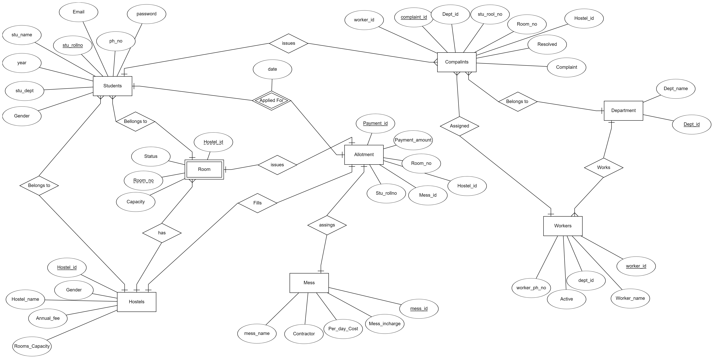

# Hostel Management System – Relational Database Design

**A relational database project built in MySQL to manage hostel operations: student records, room allotment, mess assignment, fee payments, and maintenance complaints handled by hostel workers.**

<p align="center">
  
  
  
  
</p>

---

## Table of Contents

1. [Project Overview](#1-project-overview)
2. [Objectives](#2-objectives)
3. [Tools and Technologies](#3-tools-and-technologies)
4. [Database Design](#4-database-design)
5. [Entity Relationship Diagram](#5-entity-relationship-diagram)
6. [Relational Schema](#6-relational-schema)
7. [Table Descriptions](#7-table-descriptions)
8. [Sample Data](#8-sample-data)
9. [Sample Queries and Results](#9-sample-queries-and-results)
10. [Project Structure](#10-project-structure)
11. [How to Run the Project](#11-how-to-run-the-project)
12. [Limitations and Future Improvements](#12-limitations-and-future-improvements)
13. [Author](#13-author)

---

## 1. Project Overview

Running a hostel means keeping track of a lot of connected information: which student lives in which room, which mess they eat at, whether their fee has been paid, and whether the leaking tap they reported last week has been fixed.

When this information is kept in registers or separate spreadsheets, it becomes hard to answer simple questions such as *"Which rooms are vacant?"* or *"Which complaints are still pending?"*

This project designs a **centralized relational database** for hostel administration. It models **8 entities**: Students, Hostel, Room, Mess, Allotment, Work (maintenance departments), Workers, and Complaints. Primary keys, foreign keys, and constraints link them together and keep the data consistent.

The project covers the full database design process:

- Conceptual design using an **Entity Relationship (ER) diagram**
- Logical design using a **relational schema**
- Physical implementation using **SQL DDL** scripts
- Sample data population using **SQL DML** scripts
- Data retrieval using **SQL queries** that answer real administrative questions

## 2. Objectives

The main objectives are to:

- Design a normalized database that represents real hostel operations.
- Store student, hostel, room, and mess information in one place.
- Record room allotments along with fee payment details.
- Track maintenance complaints from the moment they are raised to when they are resolved.
- Assign complaints to workers based on their maintenance department.
- Maintain data integrity using primary keys, foreign keys, `NOT NULL`, `UNIQUE`, and referential actions.
- Answer common administrative questions using SQL queries.

### Key Questions the Database Answers

1. Which rooms are currently vacant?
2. Which workers have unresolved complaints assigned to them?
3. What complaints has a particular student raised?
4. Which students have not been allotted a room yet?
5. Which students are staying in a particular room?

## 3. Tools and Technologies

| Category | Tools |
|---|---|
| Database Management System | MySQL |
| Query Language | SQL (DDL, DML, nested queries) |
| Database Design | ER Diagram, Relational Schema |
| Diagramming | draw.io |
| Development Environment | MySQL Workbench / MySQL CLI |
| Version Control | Git, GitHub |

## 4. Database Design

### 4.1 Entities

| # | Entity | Description |
|---|---|---|
| 1 | **Students** | Personal and academic details of hostel residents |
| 2 | **Hostel** | Hostel blocks, their capacity, annual fee, and gender |
| 3 | **Room** | Rooms in each hostel, their capacity, and occupancy status |
| 4 | **Mess** | Mess facilities, daily cost, in-charge, and contractor |
| 5 | **Allotment** | Fee payment and the room and mess assigned to a student |
| 6 | **Work** | Maintenance departments (Carpentry, Cleaning, Plumbing, Electrical, LAN) |
| 7 | **Workers** | Maintenance staff, their department, and performance |
| 8 | **Complaints** | Maintenance issues raised by students and the worker assigned |

### 4.2 Relationships

| Relationship | Type | Description |
|---|---|---|
| Hostel → Room | One-to-Many | A hostel has many rooms. `Room` is a **weak entity** identified by `(Room_no, Hostel_id)`. |
| Students → Allotment | One-to-Many | A student applies for an allotment (payment record). |
| Hostel / Room → Allotment | One-to-Many | Each allotment places a student in a specific hostel and room. |
| Mess → Allotment | One-to-Many | Each allotment assigns the student to a mess. |
| Students → Complaints | One-to-Many | A student can raise multiple complaints. |
| Work → Workers | One-to-Many | Each worker belongs to one maintenance department. |
| Work → Complaints | One-to-Many | Each complaint belongs to a maintenance department. |
| Workers → Complaints | One-to-Many | Each complaint is assigned to one worker. |
| Room / Hostel → Complaints | One-to-Many | Each complaint is linked to the room and hostel where the issue exists. |

### 4.3 Integrity Constraints

- **Primary keys** on every table, including a **composite key** `(Room_no, Hostel_id)` on `Room`.
- **Foreign keys** connect `Allotment` and `Complaints` to the tables they reference.
- **`ON DELETE CASCADE`**: deleting a hostel automatically removes its rooms.
- **`ON DELETE SET NULL`**: deleting a student, room, mess, worker, or department keeps the allotment or complaint history but clears the reference.
- **`UNIQUE`** on student phone number, student email, and worker phone number.
- **`NOT NULL`** on all essential attributes.
- **`DEFAULT false`** on `Complaints.Resolved`, so every new complaint starts as pending.

## 5. Entity Relationship Diagram

The ER diagram shows the entities, their attributes, primary keys (underlined), and the relationships between them.



## 6. Relational Schema

The relational schema converts the ER diagram into tables, showing primary keys (PK), foreign keys (FK), and data types.


## 7. Table Descriptions

### Students

| Column | Type | Constraint |
|---|---|---|
| Stu_roll_no | VARCHAR(9) | Primary Key |
| Stu_name | VARCHAR(30) | NOT NULL |
| Stu_dept | VARCHAR(10) | NOT NULL |
| Stu_ph_no | VARCHAR(10) | UNIQUE |
| Email | VARCHAR(20) | UNIQUE |
| Gender | VARCHAR(6) | NOT NULL |
| Stu_year | INT | NOT NULL |
| Password | VARCHAR(16) | NOT NULL |

### Hostel

| Column | Type | Constraint |
|---|---|---|
| Hostel_id | VARCHAR(10) | Primary Key |
| Hostel_name | VARCHAR(10) | NOT NULL |
| Rooms_capacity | INT | NOT NULL |
| Annual_fee | INT | NOT NULL |
| Gender | VARCHAR(6) | NOT NULL |

### Room

| Column | Type | Constraint |
|---|---|---|
| Room_no | VARCHAR(6) | Composite Primary Key |
| Hostel_id | VARCHAR(10) | Composite Primary Key, FK → Hostel (ON DELETE CASCADE) |
| Capacity | INT | NOT NULL |
| Status | BOOL | NOT NULL (`true` = occupied, `false` = vacant) |

### Mess

| Column | Type | Constraint |
|---|---|---|
| Mess_id | VARCHAR(10) | Primary Key |
| Mess_name | VARCHAR(15) | NOT NULL |
| Per_day_cost | INT | NOT NULL |
| Mess_incharge | VARCHAR(10) | NOT NULL |
| Contractor | VARCHAR(15) | NOT NULL |

### Allotment

| Column | Type | Constraint |
|---|---|---|
| Payment_id | VARCHAR(10) | Primary Key |
| Payment_amount | INT | NOT NULL |
| Payment_date | DATE | NOT NULL |
| Hostel_id | VARCHAR(10) | FK → Hostel |
| Room_no | VARCHAR(6) | FK → Room |
| Stu_roll_no | VARCHAR(9) | FK → Students |
| Mess_id | VARCHAR(15) | FK → Mess |

### Work

| Column | Type | Constraint |
|---|---|---|
| Work_dept_id | VARCHAR(10) | Primary Key |
| Dept_name | VARCHAR(10) | NOT NULL |

### Workers

| Column | Type | Constraint |
|---|---|---|
| Worker_id | VARCHAR(10) | Primary Key |
| Worker_name | VARCHAR(30) | NOT NULL |
| Worker_ph_no | VARCHAR(10) | UNIQUE |
| Work_dept_id | VARCHAR(10) | FK → Work |
| Active | BOOL | NOT NULL |
| Complaints_resolved | INT | NOT NULL |

### Complaints

| Column | Type | Constraint |
|---|---|---|
| Complaint_id | VARCHAR(10) | Primary Key |
| Stu_roll_no | VARCHAR(9) | FK → Students |
| Work_dept_id | VARCHAR(10) | FK → Work |
| Room_no | VARCHAR(6) | FK → Room |
| Hostel_id | VARCHAR(10) | FK → Hostel |
| Complaint | VARCHAR(100) | NOT NULL |
| Worker_id | VARCHAR(10) | FK → Workers |
| Resolved | BOOL | DEFAULT false |

## 8. Sample Data

The database is populated with sample records modelled on a college hostel campus.

| Table | Records | Details |
|---|---:|---|
| Hostel | 8 | 5 boys' hostels, 3 girls' hostels |
| Room | 15 | 10 occupied, 5 vacant |
| Students | 20 | Students from 9 departments, years 2–4 |
| Mess | 4 | 3 boys' messes, 1 girls' mess |
| Allotment | 16 | 16 of 20 students allotted a room |
| Work | 5 | Carpentry, Cleaning, Plumbing, Electrical, LAN |
| Workers | 8 | 6 active, 2 inactive |
| Complaints | 7 | 4 resolved, 3 pending |

### Hostels

| Hostel_id | Name | Capacity | Annual Fee (₹) | Gender |
|---|---|---:|---:|---|
| hst1 | Ultra Mega | 1800 | 10,000 | Male |
| hst2 | Mega | 1000 | 9,000 | Male |
| 3blk | Block 3 | 48 | 9,500 | Male |
| 4blk | Block 4 | 48 | 9,500 | Male |
| 6blk | Block 6 | 48 | 9,500 | Male |
| LHA | Ladies A | 500 | 12,500 | Female |
| LHB | Ladies B | 500 | 12,500 | Female |
| LHC | Ladies C | 500 | 12,500 | Female |

## 9. Sample Queries and Results

The `Query*.sql` files use **nested subqueries** to answer common administrative questions.

### Query 1: Find all vacant rooms

```sql
SELECT Room_no FROM Room WHERE Status = false;
```

**Result:** `6304`, `6212`, `1418`, `B106`, `3232`

**Use case:** Helps the warden allot rooms to new students quickly.

### Query 2: Find workers who have unresolved complaints

```sql
SELECT Worker_name FROM Workers WHERE Worker_id IN
  (SELECT Worker_id FROM Complaints WHERE Resolved = false);
```

**Result:** `Ramesh`, `Rakesh`, `Sharma`

**Use case:** Lets the administration follow up on pending maintenance work.

### Query 3: Find all complaints raised by a particular student

```sql
SELECT Complaint FROM Complaints WHERE Stu_roll_no IN
  (SELECT Stu_roll_no FROM Students WHERE Stu_name = 'Preetham P');
```

**Result:** `Room cleaning`

**Use case:** Shows a student's complaint history.

### Query 4: Find students who have not been allotted a room

```sql
SELECT Stu_name FROM Students WHERE Stu_roll_no NOT IN
  (SELECT Stu_roll_no FROM Allotment);
```

**Result:** `Nikhil Boob`, `Krishna K V`, `Ravichandra k`, `Naveen NS`

**Use case:** Identifies students still waiting for hostel accommodation.

### Query 5: Find the students staying in a particular room

```sql
SELECT Stu_name FROM Students WHERE Stu_roll_no IN
  (SELECT Stu_roll_no FROM Allotment WHERE Room_no = '1216');
```

**Result:** `Sree Harshitha`, `Madhavi P`

**Use case:** Shows the occupants of a room for verification or inspection.

## 10. Project Structure

```text
Hostel-Management-System/
│
├── Sql codes/
│   ├── db.sql                  # Creates the database
│   │
│   ├── hostel.sql              # CREATE TABLE scripts
│   ├── room.sql
│   ├── students.sql
│   ├── mess.sql
│   ├── work.sql
│   ├── workers.sql
│   ├── allotment.sql
│   ├── complaints.sql
│   │
│   ├── INSERT_HOSTEL.sql       # Sample data scripts
│   ├── INSERT_ROOMS.sql
│   ├── INSERT_STUDENTS.sql
│   ├── INSERT_MESS.sql
│   ├── INSERT_WORK.sql
│   ├── INSERT_WORKERS.sql
│   ├── INSERT_ALLOTMENT.sql
│   ├── INSERT_COMPLAINTS.sql
│   │
│   └── Query1.sql – Query5.sql # Sample queries
│
├── ERD.png                     # Entity Relationship Diagram
├── relationship schema.png     # Relational schema
└── README.md
```

## 11. How to Run the Project

### Prerequisites

- MySQL Server
- MySQL Workbench or the MySQL command-line client

### Step 1: Clone the repository

```bash
git clone https://github.com/TheAslamSyed/Hostel-Management-System.git

cd Hostel-Management-System
```

### Step 2: Create the database

```sql
CREATE DATABASE HOSTEL_MANAGEMENT_SYSTEM;
USE HOSTEL_MANAGEMENT_SYSTEM;
```

### Step 3: Create the tables

Tables must be created in this order, because a table can only reference tables that already exist:

```text
1. hostel.sql
2. room.sql
3. students.sql
4. mess.sql
5. work.sql
6. workers.sql
7. allotment.sql
8. complaints.sql
```

### Step 4: Insert the sample data

Insert data in the same dependency order:

```text
1. INSERT_HOSTEL.sql
2. INSERT_ROOMS.sql
3. INSERT_STUDENTS.sql
4. INSERT_MESS.sql
5. INSERT_WORK.sql
6. INSERT_WORKERS.sql
7. INSERT_ALLOTMENT.sql
8. INSERT_COMPLAINTS.sql
```

### Step 5: Run the queries

Open and execute `Query1.sql` to `Query5.sql`.

### Option: Run everything from the command line

```bash
cd "Sql codes"

mysql -u root -p < db.sql

for f in hostel room students mess work workers allotment complaints \
         INSERT_HOSTEL INSERT_ROOMS INSERT_STUDENTS INSERT_MESS \
         INSERT_WORK INSERT_WORKERS INSERT_ALLOTMENT INSERT_COMPLAINTS; do
  mysql -u root -p HOSTEL_MANAGEMENT_SYSTEM < "$f.sql"
done

mysql -u root -p -t HOSTEL_MANAGEMENT_SYSTEM < Query1.sql
```

**Tip:** In MySQL Workbench, run `USE HOSTEL_MANAGEMENT_SYSTEM;` first, then open each script and execute it with the lightning-bolt icon.

## 12. Limitations and Future Improvements

### Current Limitations

- **Passwords are stored as plain text.** A real system should store salted hashes, such as bcrypt.
- **Composite key reference:** `Allotment` and `Complaints` reference `Room(Room_no)` alone, while the primary key of `Room` is `(Room_no, Hostel_id)`. Older MySQL versions accept this, but newer ones may reject it by default. A composite foreign key `(Room_no, Hostel_id)` would be the cleaner design.
- **Room status is updated manually.** It does not change automatically when a student is allotted a room.
- **Sample data contains a few inconsistencies.** For example, some allotment payment amounts do not match the hostel's annual fee.

### Future Improvements

- Add **triggers** to update room status automatically when an allotment is made or removed.
- Add **CHECK constraints** for gender, year, and occupancy not exceeding room capacity.
- Create **views** for common reports, such as pending complaints and hostel occupancy.
- Add **stored procedures** for allotting rooms and assigning complaints.
- Use **JOIN-based queries** alongside the nested subqueries.
- Track complaint timestamps (raised and resolved dates) to measure resolution time.
- Build a **web interface** (for example, Node.js/Express or Spring Boot) for students, wardens, and workers.
- Add **role-based access control** for students, wardens, and administrators.

## 13. Author

**Syed Abdul Aslam Shareef**

B.Tech, National Institute of Technology Warangal

- **GitHub:** [@TheAslamSyed](https://github.com/TheAslamSyed)
- **LinkedIn:** [Aslam Syed](https://www.linkedin.com/in/aslam-syed-8a9b7b303)

---

*This project demonstrates practical skills in database design, ER modelling, relational schema design, SQL DDL and DML, integrity constraints, and writing queries to answer real administrative questions.*

If you found this project useful, consider giving it a ⭐
