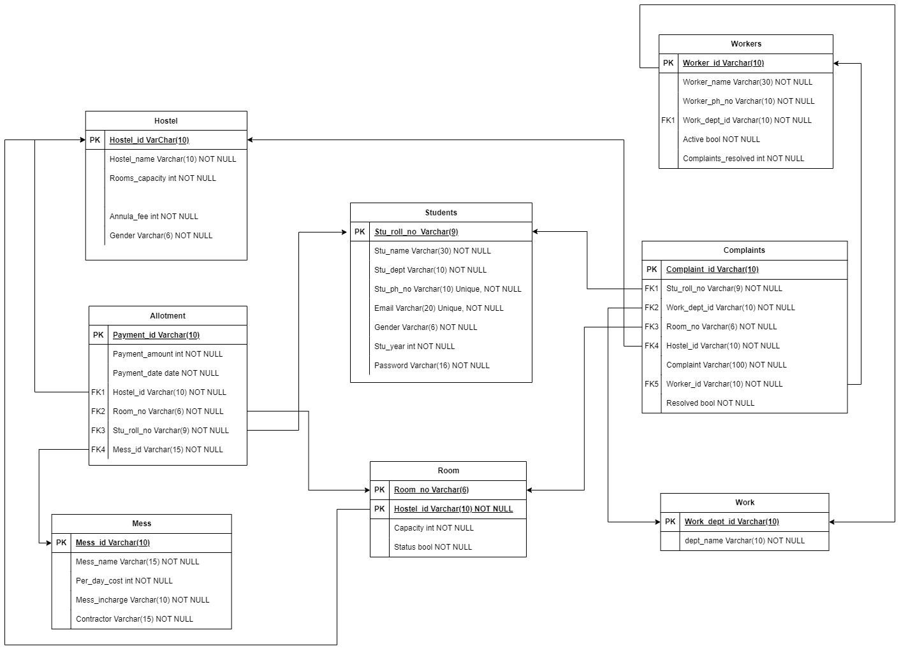

# Hostel Management System
 Welcome to Hostel Database Management system Project!
 
 If you like the repo do ⭐ it.
# Project Overview
 The Hostel Database project is designed to provide a centralized system for managing hostel-related data. It aims to simplify tasks such as managing student records, room allocations, maintenance requests, and overall hostel administration. The project utilizes a relational database management system to store and retrieve data efficiently.

# Basic Structure
## Database Entities
 There are 8 entities in this database. They are
 - Students
 - Hostel
 - Rooms
 - Work
 - Worker
 - Mess
 - Allotment
 - Complaints

 Each entity consists of several attributes.

## Entity Relationship diagram

## Relationship Schema

